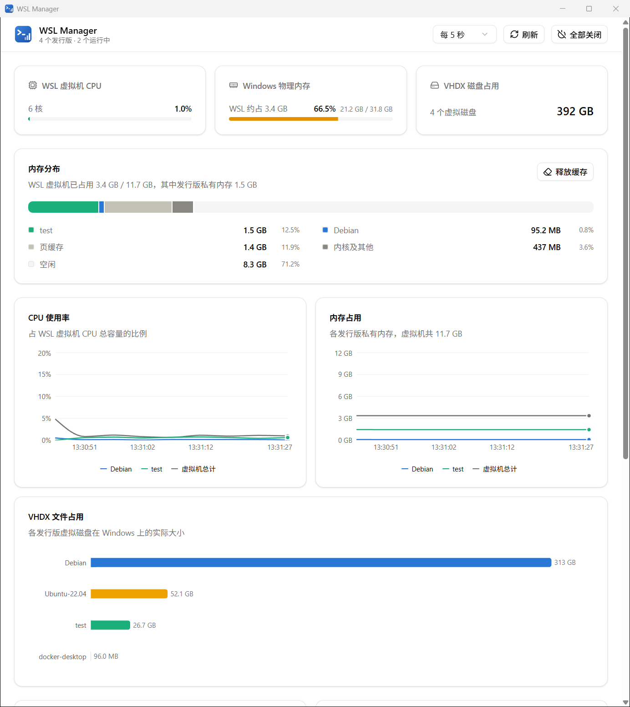

<p align="center">
  
</p>

<h1 align="center">WSL Manager</h1>

<p align="center">
  一个轻量的 Windows 桌面应用，用来查看各个 WSL 发行版分别占用了多少 CPU、内存和磁盘。<br/>
  基于 Tauri 2 + React 19 + shadcn/ui。
</p>



## 为什么做这个

WSL2 的所有发行版都跑在同一个虚拟机里。在任务管理器里只能看到一个 `vmmem` / `vmmemWSL` 进程吃掉了一大块内存，
却看不出是哪个发行版、哪部分占用的。电脑内存紧张时，WSL Manager 可以直接告诉你：

- 每个发行版各自用了多少内存，谁是大头
- 有多少是可以回收的页缓存（WSL 不会主动还给 Windows），一键释放
- WSL 在整个 Windows 物理内存里大约占了多少

## 功能

- **内存分布**：一根堆叠条拆分 WSL 虚拟机内存：各发行版私有内存、页缓存、内核及其他、空闲，附带明细排名
- **释放缓存**：清空 Linux 页缓存，释放出的内存会归还给 Windows
- **Windows 物理内存**：总用量，以及其中 WSL 大约占用多少
- **趋势图**：各发行版 CPU 和内存的变化曲线，并附虚拟机总计（保留最近 60 个采样点）
- **VHDX 占用**：每个发行版虚拟磁盘文件在 Windows 上的实际大小，已停止的发行版也能看
- **发行版卡片**：CPU / 内存 / 根分区磁盘使用率、进程数、默认发行版、WSL 版本
- **管理操作**：打开终端（优先 Windows Terminal）、设为默认、终止发行版、关闭全部 WSL
- 刷新间隔可选 2 秒 / 5 秒 / 10 秒 / 暂停，窗口最小化时自动暂停；跟随系统深色模式

## 统计口径

| 指标 | 来源与计算方式 |
|---|---|
| 发行版 CPU | 两次刷新之间该发行版所有进程 `utime + stime` 的增量 ÷ 同期 `/proc/stat` 总时间，即占整个虚拟机 CPU 容量的比例 |
| 发行版内存 | 所有进程 `/proc/<pid>/statm` 的 `resident − shared` 之和，即**私有内存**。共享内存和文件页不计入，避免与页缓存或其它进程重复计算 |
| 页缓存 | `/proc/meminfo` 中 `Buffers + Cached + SReclaimable` |
| 内核及其他 | 虚拟机已用（`MemTotal − MemFree`）减去页缓存和各发行版私有内存，包含内核和 WSLg 系统发行版等 |
| 磁盘 | 发行版内 `df /`，即 ext4.vhdx 文件系统的使用情况 |
| VHDX 占用 | 从注册表 `HKCU\Software\Microsoft\Windows\CurrentVersion\Lxss` 找到虚拟磁盘路径后读取文件大小 |
| Windows 内存 | `GlobalMemoryStatusEx`；WSL 占用按虚拟机 `MemTotal − MemFree` 估算 |

WSL2 的发行版共享一个内核，但各自有独立的 PID 命名空间，所以 `/proc/stat`、`/proc/meminfo` 反映整个虚拟机，
而 `/proc/<pid>` 只包含本发行版的进程，单个发行版的数据由此得到。

## 实现要点

- **常驻采样会话**：应用为每个运行中的发行版保持一个 `wsl.exe -d <name> --exec sh` 进程，每次刷新只往它的 stdin
  写一条采样命令，不必每次都重新启动 `wsl.exe`。多个发行版的采样并行进行，一次刷新约 40ms（首次约 400ms）。
- **不会唤醒已停止的发行版**：只对 `wsl --list --running` 中的发行版采样，发行版停止后对应会话自动关闭。
  不过应用打开期间，常驻会话会让正在运行的发行版保持运行，不会因空闲而被 WSL 自动停止。
- 发行版列表、默认发行版、WSL 版本直接读注册表，不依赖 `wsl -l -v` 的输出格式和系统语言。

## 开发

需要 Windows 10/11 + WSL2、[Rust](https://rustup.rs/)、Node.js 和 pnpm。

```bash
pnpm install
pnpm tauri dev                 # 开发模式
pnpm tauri build               # 打包安装程序（MSI / NSIS）
pnpm tauri build --no-bundle   # 只生成 exe：src-tauri/target/release/wsl-manager.exe
```

修改图标：编辑 `app-icon.svg` 后运行 `pnpm tauri icon app-icon.svg`。

## 目录结构

```
src-tauri/src/wsl.rs                 采样会话、注册表读取、数据解析、wsl.exe 管理命令
src-tauri/src/lib.rs                 Tauri 命令
src/App.tsx                          主界面与轮询
src/components/memory-breakdown.tsx  内存分布
src/components/charts.tsx            趋势图、VHDX 条形图（Recharts）
src/components/distro-card.tsx       发行版卡片
src/lib/history.ts                   趋势历史数据与配色分配
```
